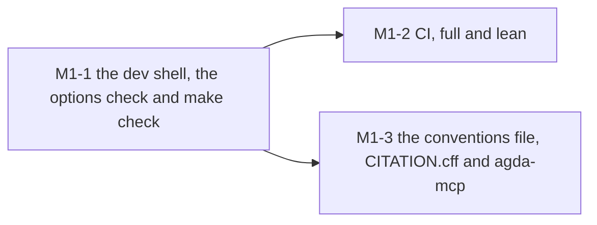
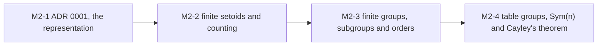
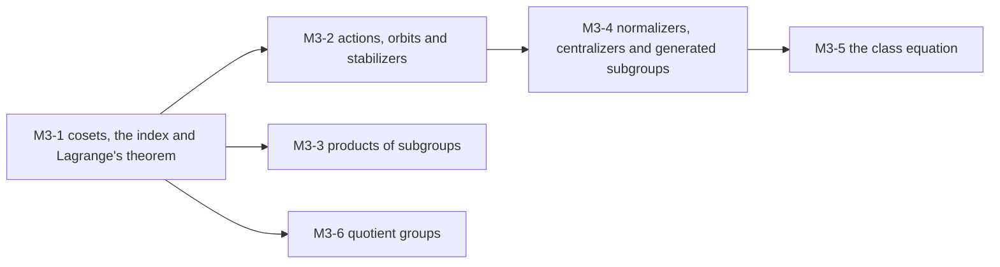
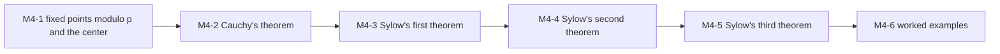
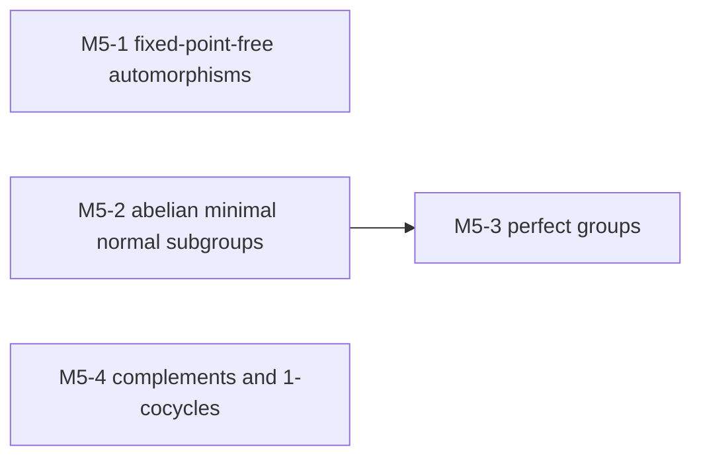
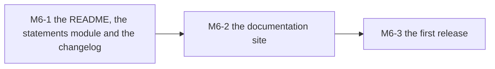
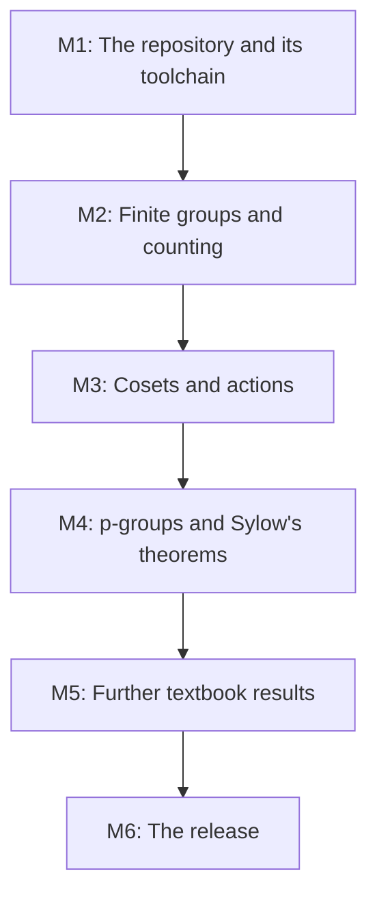

<!-- File: docs/GITHUB_PROJECT.md -->
<!--
The plan of agda-groups, a library of finite group theory in Agda, in the
github-project plan format.  Prose outside the marked regions is
hand-edited.  The issue listings between the BEGIN GENERATED and END
GENERATED markers hold the proposed issue bodies until `make populate`
creates the issues; after that, `make update` regenerates them from GitHub,
and an issue's body is edited on GitHub.  The engine reads
`### Milestone N: Title` headings, `- ` bullets in the Labels section, and
`**Labels**:` lines; everything else is prose.  The per-milestone graphs
and the order of work are hand-written, and `make update` never touches
them.
-->

# agda-groups: finite group theory in Agda

**Project Title**: agda-groups, a library of finite group theory on the
Agda Universal Algebra Library

**Repository**: `ualib/agda-groups`

---

## Summary

agda-groups is a library of finite group theory in Agda, on the group
theory of the Agda Universal Algebra Library (`ualib/agda-algebras`), as
`ualib/agda-lattices` is a library of lattice theory on it.  agda-algebras
develops groups as algebras of a signature: subgroups and their lattice,
cosets, conjugation, normal subgroups as congruences, minimal normal
subgroups, complements and permuting subgroups, Dedekind's rule,
centralizers, commutators, G-sets and the regular and coset actions,
products, wreath products, simple groups, and groups given by their tables.
It has no Lagrange's theorem, no class equation, and neither Cauchy's
theorem nor Sylow's (a search of its `master` of 2026-11-25).  This library
imports those modules and adds the counting of finite group theory and the
theorems that rest on it: finite groups and the orders of their subgroups;
Lagrange's theorem, the orbit-stabilizer theorem, the product formula and
the class equation; Cauchy's theorem, the center of a p-group and Sylow's
three theorems in full; and a first set of further textbook results.
Every module is checked under `--without-K --exact-split --safe`, with no
postulate.

Six milestones: the repository and its toolchain (M1); finite groups and
counting, beginning with the decision on how a finite group and its
subgroups are represented (M2); cosets, actions and quotients (M3);
p-groups and Sylow's theorems (M4); further textbook results (M5); and the
release (M6).

---

## Scope and decisions

+  **On agda-algebras' group theory, not beside it**.  The library imports
   agda-algebras' group modules (`Classical.Structures.Group` and its
   submodules, `Classical.Bundles.Group`, `Setoid.Algebras.Finite` and the
   examples of `Examples.Classical.Groups`) and adds what they lack; it
   neither copies nor moves them, since other libraries import them too.
   Whether some of them move here later is a decision for an ADR after the
   first release.
+  **The toolchain** (William, 2026-11-25).  Agda 2.9.0 and agda-stdlib
   2.4.1, both from agda-algebras' own flake, at a commit of its `master`
   at or after `66c324f8`, the merge that moved it to those releases;
   pinned by agda-algebras' release once one exists on them.  Every module
   carries `--without-K --exact-split --safe` and no module has a
   postulate; an options check enforces both (M1-1).  The library does not
   depend on agda-lattices.
+  **One notion of finite group**.  The representation of a finite group
   and of its subgroups is decided once, in ADR 0001 (M2-1): groups whose
   elements can be enumerated and compared, and subgroups that are
   decidable, so that their orders can be counted.  Every later issue
   states its types over it, which is why it comes first.
+  **Two rules for the types of subgroups**.  Under `--without-K --safe`,
   two subgroups with the same elements are not propositionally equal, so
   an equality of subgroups is stated as a pair of inclusions.  A premise
   that ends in a disjunction about every subgroup proves excluded middle,
   since a subgroup can be built from an arbitrary proposition, so such a
   premise carries a witness instead: "a subgroup between H and K that
   holds an element outside H contains K".  Every issue that states a type
   respects both, whatever ADR 0001 decides.
+  **Results named as textbooks name them**.  Each issue states what it
   proves as a textbook states it and cites the result by its number in
   the books of the next section.  Choosing one of them as the main
   reference, by whose numbers a statements module names the results (as
   agda-lattices names those of Freese, Ježek and Nation), is William's
   decision, deferred on 2026-11-25 to M6-1.
+  **Outside this plan**: Clifford's theorem, which is about modules over
   a field (Gorenstein 3.4.1), something neither library has yet
   (William, 2026-11-25).
+  **CI** (William, 2026-11-25).  The full check, `make check`, runs on
   GitHub's runners for every push to a pull request and to `main`, and a
   lean check without Agda runs beside it.  Both read the public Cachix
   cache `formalverification` and push nothing (M1-2).
+  **The rest** (William, 2026-11-25): the license is Apache-2.0, as
   ualib's other libraries have it; the modules are named `Groups.*`; and
   a documentation site like agda-lattices' comes with the release (M6-2).
+  **The plan is William's**: `make populate` and `make update` are his to
   run, or a session's at his word.

---

## Sources

Each issue cites a result by its number in the following books, read from
the books on 2026-11-25; a book that does not state a result is not cited
for it.

+  **Gorenstein**: D. Gorenstein, *Finite Groups*, 2nd ed., Chelsea, 1980.
   The book numbers a result inside a chapter as 2.1 and cites it from
   another chapter as 1.2.1, the form used here.
+  **Isaacs**: I. M. Isaacs, *Finite Group Theory*, Graduate Studies in
   Mathematics 92, American Mathematical Society, 2008.  The results of
   its appendix, The Basics, are numbered X.1, X.2, and so on.
+  **Aschbacher**: M. Aschbacher, *Finite Group Theory*, 2nd ed.,
   Cambridge Studies in Advanced Mathematics 10, Cambridge University
   Press, 2000.
+  **Kurzweil and Stellmacher**: H. Kurzweil and B. Stellmacher, *The
   Theory of Finite Groups: An Introduction*, Universitext, Springer, 2004.
+  **Rotman**: J. J. Rotman, *An Introduction to the Theory of Groups*, 4th
   ed., Graduate Texts in Mathematics 148, Springer, 1995.

---

## Labels

- `milestone-1-toolchain` (0e8a16): Milestone 1: The repository and its toolchain.
- `milestone-2-finite-groups` (1d76db): Milestone 2: Finite groups and counting.
- `milestone-3-cosets-actions` (b60205): Milestone 3: Cosets and actions.
- `milestone-4-sylow` (d93f0b): Milestone 4: p-groups and Sylow's theorems.
- `milestone-5-further` (e99695): Milestone 5: Further textbook results.
- `milestone-6-release` (c5def5): Milestone 6: The release.
- `formalization` (6f42c1): Agda: statements and proofs checked under the library's flags.
- `design` (5319e7): A design decision, recorded in an ADR under docs/adr/.
- `documentation` (0075ca): Improvements or additions to documentation

---

## Milestones

### Milestone 1: The repository and its toolchain

**Description**:

The repository made an Agda library: a Nix dev shell with Agda 2.9.0,
agda-stdlib 2.4.1 and agda-algebras from agda-algebras' own flake, the
library file, an options check for the flags and against postulates,
`make check` and `make check-lean` (M1-1); CI, with the full check on every
pull request and on `main` and a lean check beside it (M1-2); and the
conventions file, `CITATION.cff` and agda-mcp (M1-3).

**Exit criterion**:

`nix develop --command make check` passes from a clean clone, and both
workflows pass on GitHub for a pull request and for `main`.

#### Dependencies among the issues

An arrow from A to B, here and in every graph below, means that B needs A.
M1-1 can start at once: agda-algebras moved to the released Agda 2.9.0 and
agda-stdlib 2.4.1 in its pull request 642, merged on 2026-11-24.

---

### Milestone 2: Finite groups and counting

**Description**:

The representation of a finite group and of its subgroups, decided in ADR
0001 after a full search of prior formalizations and a spike in Agda
(M2-1); counting on finite setoids: sizes, decidable subsets, bijections,
sums over a decidable partition, and that a one-to-one map from a finite
setoid to itself is onto (M2-2); finite groups, their decidable subgroups
and their orders, with agda-algebras' notions on them (M2-3); and the
groups given by tables, the cyclic and symmetric groups on `Fin n`, and
Cayley's theorem (M2-4).

**Exit criterion**:

ADR 0001 is accepted, and the orders of agda-algebras' worked examples and
of their subgroups are computed by Agda, under the flags with no postulate.

#### Dependencies among the issues

M2-1 needs the toolchain (M1-1).

---

### Milestone 3: Cosets and actions

**Description**:

Cosets, the index and Lagrange's theorem (M3-1); actions of a finite group
on a finite setoid, orbits, stabilizers and the orbit-stabilizer theorem
(M3-2); the product formula and internal direct products (M3-3);
conjugation, normalizers, centralizers, the center, the subgroup generated
by a subset and the order of an element (M3-4); conjugacy classes and the
class equation (M3-5); and quotient groups with the correspondence theorem
(M3-6).

**Exit criterion**:

Each result is proved for every finite group under the flags with no
postulate, and cites its textbook source.

#### Dependencies among the issues

M3-1 needs the finite groups and their subgroups (M2-3).

---

### Milestone 4: p-groups and Sylow's theorems

**Description**:

The fixed points of a p-group acting on a finite setoid, counted modulo p,
and the center of a nontrivial p-group (M4-1); Cauchy's theorem (M4-2);
Sylow's three theorems in full: existence, with every p-subgroup in a
Sylow p-subgroup (M4-3), conjugacy (M4-4), and the number of Sylow
p-subgroups (M4-5); and worked examples (M4-6).

**Exit criterion**:

Sylow's three theorems are proved for every finite group and every prime
under the flags with no postulate, and the numbers of Sylow subgroups of
the worked examples are computed by Agda.

#### Dependencies among the issues

M4-1 needs the actions and the center (M3-2, M3-4); M4-2 needs the cyclic
groups (M2-4); M4-3 needs the quotient groups (M3-6); and M4-5 needs the
product formula (M3-3).

---

### Milestone 5: Further textbook results

**Description**:

Fixed-point-free automorphisms, Gorenstein's Theorem 10.1.2 (M5-1);
characteristic subgroups, and that an abelian minimal normal subgroup is
elementary abelian (M5-2); the commutator subgroup, perfect groups, and
that a nonabelian minimal normal subgroup is perfect (M5-3); and the
complements of an abelian normal subgroup and their 1-cocycles (M5-4).

**Exit criterion**:

Each result is proved for every finite group under the flags with no
postulate, and cites its textbook source.

#### Dependencies among the issues

M5-1 needs Sylow's second theorem (M4-4); M5-2 needs Cauchy's theorem
(M4-2); M5-3 needs the quotient groups (M3-6); and M5-4 needs only the
products of subgroups (M3-3), so it can start beside Milestone 4.

---

### Milestone 6: The release

**Description**:

The README's account of the results with their sources, a module that
states each textbook result once, and the changelog (M6-1); the
documentation site (M6-2); and the first release, tagged and archived by
Zenodo with a DOI (M6-3).

**Exit criterion**:

`v0.1.0` is tagged on `main`, checks from a fresh clone and from its
archived copy, and its DOI is in `CITATION.cff` and the README.

#### Dependencies among the issues

M6-1 needs the results (M4-6, M5-1, M5-3, M5-4).

---

### Milestone dependencies

Hand-written, as are the graphs above.  The toolchain (M1) comes first.
The finite groups (M2) come before everything that counts.  Cosets and
actions (M3) come before Sylow's theorems (M4), and the further results
(M5) need Cauchy's theorem and Sylow's second theorem, except M5-4, which
needs only the products of subgroups.  The release (M6) needs everything.

### Order of work

+  **First**: `M1-1`, which can start now.
+  **Then the finite groups**, over which every later issue states its
   types: `M2-1` (ADR 0001), then `M2-2` and `M2-3`, in order, with `M1-2`
   and `M1-3` beside them.
+  **Then Lagrange's theorem and the orbit-stabilizer theorem**: `M3-1`,
   then `M3-2`, with `M3-3`, `M3-6` and `M2-4` beside `M3-2`.
+  **Then Sylow's theorems and fixed-point-free automorphisms**: `M3-4`,
   `M4-1`, `M4-2`, `M4-3`, `M4-4` and `M5-1`, in that order, with `M3-5`
   beside `M4-1` and `M4-5` after `M4-4`.
+  **Then the rest of Milestone 5 and the examples**: `M5-4` whenever
   `M3-3` is in; `M5-2` and then `M5-3` after `M4-2`; and `M4-6` after
   `M4-5`.
+  **Last, the release**: `M6-1`, `M6-2` and `M6-3`, in order.

---

## Issues

## Milestone 1: The repository and its toolchain

<!-- BEGIN GENERATED: milestone-1 -->

### Issue M1-1: The dev shell, the library file, the options check and make check (#2)

**Labels**: `milestone-1-toolchain`

## Description

The repository holds its plan, its README and the roadmap engine.  This issue makes it an Agda library, as follows:

+  **The flake**.  Agda 2.9.0 and agda-stdlib 2.4.1 from the Agda environment that agda-algebras' flake exports (`packages.<system>.default`), with agda-algebras itself a flake input, pinned by `flake.lock` at a commit of its `master` at or after `66c324f8`, the merge of [agda-algebras#642], which moved it to the released Agda 2.9.0 and agda-stdlib 2.4.1 ([agda-algebras#597]); `nixpkgs` follows agda-algebras' pin.  The roadmap engine stays an input, as now.  As in the flake of [ualib/agda-deans-problem], which takes the same Agda environment, the shell copies the pinned agda-algebras sources to `.deps/` (Agda writes interface files beside a library, and the Nix store is read-only), writes a project-local `AGDA_DIR`, and puts on `PATH` an `agda` wrapper that sees the pinned libraries and nothing else.  That flake gets agda-algebras through agda-lattices; this one takes it directly, and the library does not depend on agda-lattices.  The flake's header says how it pins, as agda-algebras' header does.
+  **The library file**.  `agda-groups.agda-lib`, with `name: agda-groups`, `include: src` and `depend: standard-library-2.4 agda-algebras`, and a first module, `Groups`, with nothing in it but its header, so that the check has a module to check.  The `.gitignore` gains Agda's build products, `.agda/`, `.deps/` and the generated aggregator.
+  **The options check**.  Every `.agda` and `.lagda.md` module under `src/` opens with the options `--without-K --exact-split --safe`, and none has a `postulate` or a pragma that switches a check off; a module that breaks either rule fails the check, which names it.  The check has cases that must fail (a flag missing, an unsafe flag added, a postulate, a postulate in a code block of a literate module, a `TERMINATING` pragma) and cases that must pass (the word in prose or in a comment).  agda-lattices' `scripts/check-safety.sh` and `scripts/test-check-safety.sh` are the model: adapt them, or write the check in Python in the functional style of the github-project engine, with its tests, and say which and why.  agda-lattices lets a worked example add `--lossy-unification`, which `--safe` accepts; decide here whether this library does.
+  **The make targets**.  `make check`: the options check, then Agda on an aggregator that imports every module under `src/` (generated and gitignored), with a heap limit, then the plan's lint.  `make check-lean`: the options check, its cases and the plan's lint, with no Agda.  `make help` lists them beside the plan's targets.
+  **The README's section on checking the library**: the commands, and the lines that let Nix fetch the Agda from the public Cachix cache `formalverification` instead of building it, as agda-lattices' README gives them.

**Dependencies**: none in this plan (it starts from [agda-algebras#642], merged on 2026-11-24).

## Tasks

+  [ ] The flake and the library file, with Agda, agda-stdlib and agda-algebras from agda-algebras' flake
+  [ ] The options check and its cases
+  [ ] `make check` and `make check-lean`, and the README's section on checking

## Acceptance criteria

+  [ ] `nix develop --command make check` passes from a clean clone, and the options check fails on each of its failing cases
+  [ ] In the shell, `agda --version` reports 2.9.0, and the library file names agda-stdlib 2.4.1 and the pinned agda-algebras

[agda-algebras#597]: https://github.com/ualib/agda-algebras/issues/597

[agda-algebras#642]: https://github.com/ualib/agda-algebras/pull/642

[ualib/agda-deans-problem]: https://github.com/ualib/agda-deans-problem

---

### Issue M1-2: CI, with the full check on every pull request and on main, and a lean check (#3)

**Labels**: `milestone-1-toolchain`

## Description

Two workflows replace the template's `ci.yml`, as follows (William's decision of 2026-11-25):

+  **The full check**.  `nix develop --command make check` on GitHub's runners for every push to a pull request and every push to `main`, in one job, as agda-lattices' `check.yml` runs it.  It reads the public Cachix cache `formalverification`, which holds the Agda that agda-algebras' CI built, and pushes nothing (`skipPush`, and no Cachix token in this repository).  An `actions/cache` entry keeps `_build/` and `.deps/` (the interface files of this library and of the agda-algebras modules it imports), keyed by `flake.lock` and the sources, so that a run after the first checks only what changed.
+  **The lean check**.  `make check-lean` (the options check, its cases and the plan's lint) on the same events, with no Agda, so that a missing pragma or a broken plan is reported in a minute.
+  **For both**.  A newer push cancels the run it supersedes.  A change that touches only Markdown, other than the plan file and literate Agda (`.lagda.md`), skips the full check; if the full check becomes a required status check, the skip is a condition on its job rather than a paths filter on the workflow, since a filtered workflow leaves a required check waiting.
+  **The template's scheduled `project-plan-update.yml`**, which reports when the plan has drifted from GitHub: kept or removed, and the issue says which.
+  Record on this issue each workflow's time, for a first run on a new `flake.lock` and for a run with the cache warm.

**Dependencies**: M1-1.

## Tasks

+  [ ] The full workflow, reading the cache, with the cache of interface files
+  [ ] The lean workflow, and the template's `ci.yml` removed
+  [ ] The scheduled plan check kept or removed, and the times recorded

## Acceptance criteria

+  [ ] Both workflows pass on GitHub for a pull request and for `main`
+  [ ] A module broken on purpose fails the full check on a pull request (a throwaway branch, closed after)
+  [ ] No store path of this repository is pushed to any cache

---

### Issue M1-3: The conventions file, CITATION.cff and agda-mcp (#4)

**Labels**: `milestone-1-toolchain`, `documentation`

## Description

What a contributor reads before writing a module, and what a citation of the library needs, as follows:

+  **`CONTRIBUTING.md`**, after agda-lattices': how a contribution is checked; the layout (modules under `src/Groups/`, literate Agda in `.lagda.md` with front matter as agda-algebras' modules carry it); the flags and the options check; how a result is stated and cited (as a textbook states it, with its number in the books of the plan's [sources]); the two rules for the types of subgroups (an equality of subgroups as a pair of inclusions, and a witness in place of a disjunction about every subgroup), each with its reason; that agda-algebras' modules are imported, never copied; and what happens to a pull request.
+  **`CITATION.cff`**, validated, with the license, the repository, an abstract and keywords, as agda-lattices' has them; the DOI waits for the release (M6-3).
+  **agda-mcp**, the Agda server for coding sessions, registered for this repository; its registration lives outside the repository.

**Dependencies**: M1-1.

## Tasks

+  [ ] `CONTRIBUTING.md`, with the two rules for the types of subgroups
+  [ ] `CITATION.cff`, validated
+  [ ] agda-mcp registered

## Acceptance criteria

+  [ ] `CONTRIBUTING.md` and `CITATION.cff` on `main`, `CITATION.cff` passing its validator, and agda-mcp checking a module of the library

[sources]: https://github.com/ualib/agda-groups/blob/main/docs/GITHUB_PROJECT.md#sources

<!-- END GENERATED: milestone-1 -->

## Milestone 2: Finite groups and counting

<!-- BEGIN GENERATED: milestone-2 -->

### Issue M2-1: ADR 0001: the representation of a finite group and of its subgroups (#5)

**Labels**: `milestone-2-finite-groups`, `design`

## Description

Every later issue states its types over one notion of finite group and one of subgroup, so this issue decides them first, in `docs/adr/0001-finite-groups.md`, with the explanation in a companion note, `docs/notes/finite-groups.md`, after a full search of prior formalizations and a spike in Agda.  The notion must serve the following:

+  **Counting**.  The order of a group and of a subgroup, the index, the sizes of orbits and of conjugacy classes, and the number of Sylow p-subgroups, each a natural number that Agda computes, with the lemmas that relate them (M2-2, M3-1, M3-2, M3-5, M4-5).
+  **agda-algebras' group theory**.  A finite group must be, or give, a `Group` of `Classical.Structures.Group.Basic`, so that agda-algebras' modules apply to it unchanged: subgroups (`IsSubgroup`, `Subgroup`, `DecSubgroup`), cosets (`Coset`), conjugation and normality (`Conjugate`, `IsNormal`), centralizers, commutators, complements and permuting subgroups (`Complements`), Dedekind's rule (`dedekindˡ`), minimal normal subgroups, and the decidable normal closure over a finite group (`NormalClosureᵈ`).
+  **Computation**.  Small groups given by their tables (agda-algebras' `TableGroup` and the examples of `Examples.Classical.Groups`, up to the alternating group A₅ of order 60) have their orders and the orders of their subgroups computed by Agda, and decisions about them (is this a subgroup, is it normal) evaluated, as agda-algebras' examples evaluate them.
+  **Quotients**.  The coset space G/H and the quotient G/N by a decidable normal subgroup are finite in the same sense, without choosing representatives where the notion allows it; agda-algebras' `docs/adr/008-two-layer-congruence-discipline.md` prefers a surjective enumeration for this reason.
+  **The two rules for the types of subgroups**.  Two subgroups with the same elements are not propositionally equal under `--without-K --safe`, and a premise that ends in a disjunction about every subgroup proves excluded middle, since a subgroup can be built from an arbitrary proposition.  The ADR says how its notion meets each: where statements keep inclusions and witnesses, and whether a form of subgroup whose equality is decidable is offered beside them.

The candidates are at least the following:

+  **agda-algebras' `Group` with a finiteness witness**.  `FiniteAlgebra` of `Setoid.Algebras.Finite` gives decidable setoid equality and a surjective enumeration `enum : Fin card → G`, in which `card` bounds the order and need not be it; the order is then the number of first occurrences in the enumeration, which decidable equality computes.  agda-algebras' finite group theory uses this already (`NormalClosureᵈ`, `MinimalNormalDescent`, and `cosetAlgebra-FiniteAlgebra` for the coset space).
+  **Groups whose carrier is `Fin n`**, with propositional equality and operations given by tables, as agda-algebras' `TableGroup` builds them: the order is `n` by definition, and `eqsToGroup` makes each an agda-algebras `Group`.
+  **Groups of permutations of `Fin n`**, as subgroups of the symmetric group, with permutations stored as vectors of images so that their equality is decidable.
+  **Subgroups**, for each of these: decidable predicates (agda-algebras' `DecSubgroup`); characteristic vectors over the enumeration with a Boolean closure check, as agda-algebras' `TableGroup` makes its Boolean subgroups and as agda-stdlib's `Data.Fin.Subset` would carry them (`Subset n`, with its size `∣_∣`, its decidable `_≟_` and `⊆-antisym`), so that two subgroups with the same elements are equal and the subgroups of a group form a finite set; or lists of their elements, which have no canonical form and so suit only as input.

A first look at prior formalizations (2026-11-25), which the full search checks and extends, found the following:

+  **MathComp** (`finite_group/fingroup.v`).  A subgroup of a `finGroupType` is a finite set with a Boolean closure proof (`{group gT}`), and a finite set is a tuple over the enumeration of the type, so two subgroups with the same elements are equal with no axiom (`setP`, `group_inj`), and the Sylow subgroups form a set that can be counted.  Sylow's theorems (`solvable/sylow.v`, `Sylow's_theorem`) come in one proof, from the conjugation action on the maximal p-subgroups, the count of fixed points modulo p (`pgroup_fix_mod`), and Cauchy's theorem in N(P)/P; Cauchy's theorem (`solvable/pgroup.v`) is by induction through the class equation.
+  **Mathlib** (`Mathlib/GroupTheory/Sylow.lean`).  A subgroup is a structure on a set, and two with the same elements are equal by extensionality, which rests on function and propositional extensionality.  Sylow's first theorem grows a subgroup of order pⁿ to one of order pⁿ⁺¹ through N(H)/H and Cauchy's theorem, which is McKay's proof (`exists_prime_orderOf_dvd_card`, the rotation of the p-tuples whose product is 1).
+  **agda-unimath**.  Finite groups and decidable subgroups, whose extensionality rests on univalence; no Lagrange's theorem, Cauchy or Sylow.
+  **agda-stdlib 2.4.1**.  `Data.Fin.Subset` and its properties, `Data.Fin.Properties` (`pigeonhole`, `*↔×`, `+↔⊎`), `Data.Fin.Permutation`, sums over `Fin n` (`Algebra.Properties.CommutativeMonoid.Sum`), `Decidable⇒UIP` and the binomial coefficient `_C_`; no sum over a partition and no p-adic valuation.
+  **Isabelle's HOL-Algebra** (`Sylow.thy`).  Wielandt's count of the subsets of size pᵃ, for existence only.
+  **Agda**.  [formalverification/lean2agda]'s `corpus/subgroup-card-dvd/agda/SubgroupCardDvdFinite.agda` proves, under `--safe`, that the order of a subgroup divides the order of the group, from enumerations `A ↔ Fin n` and decidable membership, with a transversal of first elements.  No Agda proof of Cauchy's or Sylow's theorems was found.

The spike, in scratch modules on this issue's branch: for the leading candidate, the order of a group and of a subgroup computed for agda-algebras' Klein four-group, S₃ and A₅; a decidable subgroup as a finite group; the quotient by a normal subgroup as a finite group; and the statement of Sylow's third theorem typed, with the number of Sylow p-subgroups a natural number; each checked under the flags, with the time A₅ takes.  The spike is not merged as library code; what it shows is the ADR's evidence.

The ADR decides at least the following: the type of finite groups and its relation to agda-algebras' `Group`; the type of subgroups, their order and their universe level; how a statement says that two subgroups are equal, or that a subgroup lies between two others; how the conjugates of a subgroup and the Sylow p-subgroups are counted (as a finite setoid of subgroups, or as the conjugates of one subgroup indexed by the group); and the modules under `Groups` that M2-2 to M2-4 fill.  It records each decision with its evidence and its status, then a numbered decision log and its references.

**Dependencies**: M1-1.

## Tasks

+  [ ] The full search of prior formalizations, recorded in the companion note with the revisions read
+  [ ] The spike, with its timings
+  [ ] ADR 0001 and its companion note

## Acceptance criteria

+  [ ] ADR 0001 accepted by William, with every decision backed by the search or the spike
+  [ ] The types that M2-2 to M2-4 implement named in it

[formalverification/lean2agda]: https://github.com/formalverification/lean2agda

---

### Issue M2-2: Finite setoids and counting (#6)

**Labels**: `milestone-2-finite-groups`, `formalization`

## Description

The counting that every later issue uses, stated for finite setoids rather than for groups, since coset spaces, orbits, conjugacy classes, sets of tuples and sets of subgroups are all counted the same way.  On the notion of finiteness of ADR 0001, the following:

+  **The size of a finite setoid**, a natural number, with a bijection between the setoid and `Fin` of its size.  Two setoids in bijection have the same size, and a one-to-one map from a finite setoid to one of the same size is onto (the pigeonhole principle; agda-stdlib's `Data.Fin.Properties.pigeonhole` states it for `Fin`).
+  **Decidable subsets**: the size of a decidable subset and of its complement; a subset of a subset is no larger; and a subset of a subset with the same size contains it (equal, stated as inclusions).
+  **Sums and products**: the size of a disjoint union, of a product (the size of A × B is the size of A times that of B), and of the functions from `Fin k` to a finite setoid (the p-tuples of Cauchy's theorem, M4-2).
+  **Sums over a partition**.  For a decidable equivalence relation on a finite setoid, its classes form a finite setoid (by first occurrences, or as ADR 0001 says), and the size of the setoid is the sum of the sizes of its classes; if every class has k elements, the size is k times the number of classes.  This is the step that Lagrange's theorem, the orbit-stabilizer theorem and the class equation share.
+  **Sums modulo p**: a sum whose terms outside a decidable set of indices are each divisible by p is congruent modulo p to the sum of the terms in it (the step of the count of fixed points, M4-1).

agda-stdlib has the cases on `Fin` (`pigeonhole`, `*↔×`, `+↔⊎`, the sums of `Algebra.Properties.CommutativeMonoid.Sum`); reuse them.

**Dependencies**: M2-1.

## Tasks

+  [ ] Sizes and bijections, and the pigeonhole principle
+  [ ] Decidable subsets, sums and products
+  [ ] Sums over a partition, and sums modulo p

## Acceptance criteria

+  [ ] The lemmas proved under the flags with no postulate, and each one evaluated on a small finite setoid

---

### Issue M2-3: Finite groups, their subgroups and their orders (#7)

**Labels**: `milestone-2-finite-groups`, `formalization`

## Description

On the representation of ADR 0001 and the counting of M2-2, the following:

+  **Finite groups**: the type, the order of a group, and the passage to agda-algebras' `Group` (or none, if ADR 0001 makes a finite group an agda-algebras `Group` with a finiteness witness), so that every module of `Classical.Structures.Group` applies.
+  **Subgroups and their orders**: decidable subgroups and the order of each; the trivial subgroup has order 1 and the whole group its own order; and a decidable subgroup of a finite group is a finite group in its own right, so that a theorem about finite groups applies to a subgroup (a Sylow subgroup of a subgroup, a p-subgroup as a p-group).
+  **The subgroups agda-algebras builds, decidable over a finite group**: the trivial and whole subgroups, intersections, the centralizer of a decidable subset, the normal closure of an element (`NormalClosureᵈ`), and the set HK of products of two decidable subgroups as a decidable subset; inclusion of one decidable subgroup in another, decided.
+  **The notions later issues state**, each decidable over a finite group: normal subgroups; abelian groups; powers xⁿ, and elementary abelian p-groups (abelian groups in which xᵖ = 1 for every x, for a prime p); the subgroups between H and K (agda-algebras' `SubInterval`); complements (N ∩ K is trivial and NK is the whole group); and minimal normal subgroups in the witnessed form of agda-algebras' `MinimalNormalDescent`, with its descent theorem (every nontrivial normal subgroup of a finite group contains a minimal normal one) stated for the library's finite groups.
+  **The two rules for the types of subgroups, applied**.  Every equality of subgroups is a pair of inclusions, and every premise about all subgroups between two, or all normal subgroups, carries a witness (a normal subgroup inside N that holds an element other than 1 contains N; a subgroup between H and K that holds an element outside H contains K) in place of a disjunction.  The modules say so where they define the notions, with the reason.

**Dependencies**: M2-2.

## Tasks

+  [ ] Finite groups, and the passage to agda-algebras' `Group`
+  [ ] Decidable subgroups, their orders, and a subgroup as a finite group
+  [ ] agda-algebras' subgroups and notions, decidable over a finite group, and the descent theorem

## Acceptance criteria

+  [ ] The modules check under the flags with no postulate
+  [ ] The orders of agda-algebras' Klein four-group and S₃, and of their trivial and whole subgroups, computed by evaluation

---

### Issue M2-4: Table groups, the symmetric groups and Cayley's theorem (#8)

**Labels**: `milestone-2-finite-groups`, `formalization`

## Description

The concrete finite groups that the examples and Cayley's theorem need, as follows:

+  **Groups from tables**.  agda-algebras' `TableGroup` (a group on `Fin n` whose elements are given as permutations of `Fin d`, with associativity from the faithful action) gives a finite group of this library, and its Boolean subgroups give subgroups; agda-algebras' examples (`KleinFourGroup`, `CyclicGroup3`, `CyclicGroup6`, `SymmetricGroup3`, `AlternatingGroup5`) as finite groups, with their orders computed.
+  **The cyclic group ℤ/n** on `Fin n`, with addition modulo n, for every n ≥ 1 (Cauchy's theorem acts with ℤ/p, M4-2).
+  **The symmetric group Sym(n)** of the permutations of `Fin n`, as a finite group of order n!, with permutations stored so that their equality is decidable (as vectors of images, related to agda-stdlib's `Data.Fin.Permutation`); a group of permutations of `Fin n` as a subgroup of it.
+  **Cayley's theorem** (Gorenstein 1.2.16; Rotman 3.12; Isaacs, p. 2).  Every finite group G is isomorphic to a group of permutations of `Fin` of the order of G: the left regular action, through the bijection of G with `Fin` of its order (M2-2), is a one-to-one homomorphism into the symmetric group and an isomorphism onto its image.  agda-algebras' `RegularAction` (the regular action as a coset algebra) is used where it serves.

The books are those of the plan's [sources].

**Dependencies**: M2-3.

## Tasks

+  [ ] Table groups and agda-algebras' examples as finite groups
+  [ ] The cyclic groups and the symmetric groups
+  [ ] Cayley's theorem

## Acceptance criteria

+  [ ] The modules check under the flags with no postulate
+  [ ] The orders of Sym(3), Sym(4) and the examples computed by evaluation, A₅'s with the time it takes

[sources]: https://github.com/ualib/agda-groups/blob/main/docs/GITHUB_PROJECT.md#sources

<!-- END GENERATED: milestone-2 -->

## Milestone 3: Cosets and actions

<!-- BEGIN GENERATED: milestone-3 -->

### Issue M3-1: Cosets, the index and Lagrange's theorem (#9)

**Labels**: `milestone-3-cosets-actions`, `formalization`

## Description

For a finite group G and a subgroup H, the following:

+  **Cosets**.  The left cosets gH, as the classes of agda-algebras' `Coset` relation (x ∼ y when x⁻¹y ∈ H, decidable when H is); the coset space G/H as a finite setoid (agda-algebras' `cosetSetoid`, with `cosetAlgebra-FiniteAlgebra`); each coset in bijection with H, by h ↦ gh; and the right cosets, with the bijection gH ↦ Hg⁻¹ between the two coset spaces.
+  **The index** |G : H|, the number of left cosets, equal to the number of right cosets.
+  **Lagrange's theorem** (Gorenstein 1.2.1; Isaacs X.8; Aschbacher (1.5); Kurzweil and Stellmacher 1.1.7; Rotman 2.11): |G| = |G : H| |H|, so the order of H divides the order of G.
+  **The tower law** (Isaacs X.10; Rotman, Exercise 2.10): |G : K| = |G : H| |H : K| for K ≤ H ≤ G, with |H : K| the index of K in H as a finite group in its own right.
+  **Orders force inclusions**: a subgroup of H with the order of H contains H, so that an equality of subgroups can be proved from one inclusion and the orders.

The books are those of the plan's [sources].

**Dependencies**: M2-3.

## Tasks

+  [ ] Cosets, the coset space and the bijections
+  [ ] The index, Lagrange's theorem and the tower law

## Acceptance criteria

+  [ ] Proved for every finite group under the flags with no postulate
+  [ ] The index of a subgroup of order 2 in S₃ computed as 3 by evaluation

[sources]: https://github.com/ualib/agda-groups/blob/main/docs/GITHUB_PROJECT.md#sources

---

### Issue M3-2: Group actions, orbits and stabilizers (#10)

**Labels**: `milestone-3-cosets-actions`, `formalization`

## Description

For a finite group G acting on a finite setoid X, the following:

+  **Actions**.  The library's notion of an action of a finite group on a finite setoid, and how it relates to agda-algebras' `RightAction` (`Classical.Structures.Group.IndexAction`) and to its G-sets (`Classical.Structures.Group.GSet`); and the actions later issues use: left multiplication on G/H (agda-algebras' `CosetAction`), conjugation on G, and conjugation on subgroups (or on the conjugates of one subgroup, as ADR 0001 decides).
+  **Orbits, stabilizers and fixed points**.  The orbit of x, decidable by a search over G, so that the orbits partition X (M2-2); the stabilizer Gₓ, a decidable subgroup; the fixed points, a decidable subset; transitive actions, regular actions (transitive, with every stabilizer trivial), and the conjugate stabilizer of gx (the stabilizer of gx is gGₓg⁻¹, stated as inclusions).
+  **The orbit-stabilizer theorem** (Isaacs 1.4; Aschbacher (5.11); Kurzweil and Stellmacher 3.1.5; Rotman 3.19): the orbit of x is in bijection with G/Gₓ, so |Gx| = |G : Gₓ|, which divides |G|.
+  **The orbit equation**: |X| is the sum of the sizes of the orbits, that is, the sum of |G : Gₓ| over a set of representatives of the orbits.
+  **Transitive actions as coset actions** (Gorenstein 2.7.1): a transitive action of G on X is equivalent to the action on G/Gₓ, which agda-algebras' `IsCosetAction` describes; stated for finite actions where agda-algebras lacks it.

The books are those of the plan's [sources].

**Dependencies**: M3-1.

## Tasks

+  [ ] Actions, and their relation to agda-algebras' actions and G-sets
+  [ ] Orbits, stabilizers and fixed points, decidable
+  [ ] The orbit-stabilizer theorem and the orbit equation

## Acceptance criteria

+  [ ] Proved for every finite group and every finite action under the flags with no postulate
+  [ ] The orbits and stabilizers of S₃ acting on `Fin 3` computed by evaluation

[sources]: https://github.com/ualib/agda-groups/blob/main/docs/GITHUB_PROJECT.md#sources

---

### Issue M3-3: Products of subgroups and internal direct products (#11)

**Labels**: `milestone-3-cosets-actions`, `formalization`

## Description

For subgroups H and K of a finite group G, with HK the set of products hk (agda-algebras' complex product `_∙ᶜ_`), the following:

+  **The product formula** (Gorenstein 1.2.2; Isaacs X.2; Aschbacher (1.7)(3); Kurzweil and Stellmacher 1.1.6; Rotman 2.20): |HK| |H ∩ K| = |H| |K|, by the map from H × K onto HK, each of whose fibers has |H ∩ K| elements.
+  **HK is a subgroup exactly when HK = KH** (Gorenstein 1.2.2; Isaacs X.1; Aschbacher (1.7)(1); Kurzweil and Stellmacher 1.1.5; Rotman, Exercise 2.47).  agda-algebras' `Complements` has the direction from permuting (`permuting-∙ᶜ-isSubgroup`) and that a normal subgroup permutes with every subgroup (`normal-permutes`); this issue adds the converse, with HK = KH stated as inclusions.
+  **Complements**: if N ∩ K is trivial and NK = G, then |K| = |G : N|; so of two complements of N, one inside the other, each contains the other.
+  **Internal direct products** (Gorenstein 1.2.12; Isaacs X.22 and X.23; Aschbacher (1.9); Kurzweil and Stellmacher 1.6.1; Rotman 2.29): if M and N are normal and M ∩ N is trivial, then every element of M commutes with every element of N, MN is a normal subgroup of order |M| |N|, and MN is isomorphic to the product M × N of agda-algebras' `Classical.Structures.Group.Product`.
+  **Dedekind's law** (Isaacs X.3; Aschbacher (1.14)) is agda-algebras' `dedekindˡ` and `dedekindʳ` (`Classical.Structures.Group.Dedekind`); restate it here for decidable subgroups only if a statement of this library needs that form.

The books are those of the plan's [sources].

**Dependencies**: M3-1.

## Tasks

+  [ ] The product formula
+  [ ] HK a subgroup exactly when HK = KH, and the orders of complements
+  [ ] Internal direct products

## Acceptance criteria

+  [ ] Proved for every finite group under the flags with no postulate

[sources]: https://github.com/ualib/agda-groups/blob/main/docs/GITHUB_PROJECT.md#sources

---

### Issue M3-4: Conjugation, normalizers, centralizers and generated subgroups (#12)

**Labels**: `milestone-3-cosets-actions`, `formalization`

## Description

For a finite group G, the following:

+  **Normalizers**.  The normalizer of a subgroup H, the g with gHg⁻¹ ⊆ H (an equality in a finite group, by orders), as a decidable subgroup, with the conjugates of agda-algebras' `Conjugate`; H is normal in its normalizer, and H is normal in G exactly when its normalizer contains G.
+  **The number of conjugates of a subgroup** is the index of its normalizer (Gorenstein 1.2.3(iii); Isaacs 1.6; Aschbacher (5.12); Rotman 3.21(ii)), from M3-2 with G acting by conjugation on the conjugates of H.
+  **Centralizers and the center**.  The centralizer of an element and of a decidable subset (agda-algebras' `Centralizer`), decidable; the center Z(G), decidable and normal, and the set of fixed points of the conjugation action.
+  **The number of conjugates of an element** x is the index of its centralizer (Gorenstein 1.2.3(i); Isaacs 1.5; Rotman 3.21(i)).
+  **The subgroup generated by a decidable subset** S, ⟨S⟩: the least subgroup that holds S, with decidable membership (by closing S under products in finitely many steps), and leastness stated as "every subgroup that holds S holds ⟨S⟩".
+  **The order of an element** (Isaacs X.9; Kurzweil and Stellmacher 1.1.8; Rotman 2.12): the cyclic subgroup ⟨g⟩; the order of g, the least n ≥ 1 with gⁿ = 1, which exists by the pigeonhole principle and is found by search; it is the order of ⟨g⟩, so it divides the order of G, and g raised to the order of G is 1.

The books are those of the plan's [sources].

**Dependencies**: M3-2.

## Tasks

+  [ ] Normalizers, and the number of conjugates of a subgroup
+  [ ] Centralizers, the center, and the number of conjugates of an element
+  [ ] Generated subgroups and the order of an element

## Acceptance criteria

+  [ ] Proved for every finite group under the flags with no postulate
+  [ ] The center of S₃ and the orders of its elements computed by evaluation

[sources]: https://github.com/ualib/agda-groups/blob/main/docs/GITHUB_PROJECT.md#sources

---

### Issue M3-5: Conjugacy classes and the class equation (#13)

**Labels**: `milestone-3-cosets-actions`, `formalization`

## Description

For a finite group G, the following:

+  **Conjugacy classes**: x and y conjugate when y = gxg⁻¹ for some g, decidable by a search over G; the classes are the orbits of the conjugation action (M3-2), and the class of x has as many elements as the index of the centralizer of x (M3-4), so its size divides |G|; a class has one element exactly when its element is central.
+  **The class equation** (Gorenstein 1.2.3(ii); Kurzweil and Stellmacher 3.1.8; Isaacs, p. 5): |G| = |Z(G)| + Σᵢ |G : C_G(xᵢ)|, the sum over representatives xᵢ of the classes of more than one element.

The books are those of the plan's [sources].

**Dependencies**: M3-4.

## Tasks

+  [ ] Conjugacy classes and their sizes
+  [ ] The class equation

## Acceptance criteria

+  [ ] Proved for every finite group under the flags with no postulate
+  [ ] The class equation of S₃, 6 = 1 + 2 + 3, computed by evaluation

[sources]: https://github.com/ualib/agda-groups/blob/main/docs/GITHUB_PROJECT.md#sources

---

### Issue M3-6: Quotient groups and the correspondence theorem (#14)

**Labels**: `milestone-3-cosets-actions`, `formalization`

## Description

For a finite group G and a decidable normal subgroup N, the following:

+  **The quotient group G/N**: the quotient of G's underlying algebra by agda-algebras' congruence of a normal subgroup (`Classical.Structures.Group.Congruences`, with `_╱_` of `Setoid.Congruences.Basic`), as a group that satisfies the group equations, and as a finite group, finite as ADR 0001 says (by the enumeration of G, or otherwise), with |G/N| = |G : N|; and the projection from G onto G/N, a homomorphism whose kernel is N.  agda-algebras has the quotient algebra but not the quotient group.
+  **The correspondence theorem** (Gorenstein 1.2.4(ii); Isaacs X.21; Aschbacher (1.6); Rotman 2.28): the subgroups of G/N correspond to the subgroups of G that contain N, by image and preimage, preserving inclusion, normality and index, each stated with inclusions; in particular the preimage of a subgroup of G/N of order m has order m |N|.
+  **The second isomorphism theorem** (Gorenstein 1.2.6; Isaacs X.20; Aschbacher (1.7)(2); Kurzweil and Stellmacher 1.2.6; Rotman 2.26): for a subgroup H, HN/N is isomorphic to H/(H ∩ N), so |HN : N| = |H : H ∩ N|.

The books are those of the plan's [sources].

**Dependencies**: M3-1.

## Tasks

+  [ ] The quotient group, finite, with its order and the projection
+  [ ] The correspondence theorem
+  [ ] The second isomorphism theorem

## Acceptance criteria

+  [ ] Proved for every finite group under the flags with no postulate
+  [ ] The quotient of S₃ by its normal subgroup of order 3 computed as a group of order 2 by evaluation

[sources]: https://github.com/ualib/agda-groups/blob/main/docs/GITHUB_PROJECT.md#sources

<!-- END GENERATED: milestone-3 -->

## Milestone 4: p-groups and Sylow's theorems

<!-- BEGIN GENERATED: milestone-4 -->

### Issue M4-1: p-groups acting on finite setoids, and the center of a p-group (#15)

**Labels**: `milestone-4-sylow`, `formalization`

## Description

For a prime p, the following:

+  **p-groups**: a finite group whose order is a power of p; a p-subgroup of G, a subgroup whose order is a power of p; and subgroups and quotients of p-groups are p-groups (by Lagrange's theorem, M3-1 and M3-6).
+  **The fixed points of a p-group action** (Aschbacher (5.14); Kurzweil and Stellmacher 3.1.7): if a p-group P acts on a finite setoid X, then |X| ≡ |X^P| (mod p), where X^P is the set of fixed points.  Every orbit outside X^P has a power of p greater than 1 as its size (the orbit-stabilizer theorem, M3-2), so the orbit equation reduces modulo p to the fixed points (M2-2).
+  **A nontrivial p-group has a nontrivial center** (Gorenstein 1.2.11(i); Isaacs 1.19; Aschbacher (5.16); Kurzweil and Stellmacher 3.1.11; Rotman 4.4): P acting on itself by conjugation fixes exactly Z(P), so |Z(P)| ≡ |P| ≡ 0 (mod p); stated with a witness, an element of Z(P) other than 1.

The books are those of the plan's [sources].

**Dependencies**: M3-2, M3-4.

## Tasks

+  [ ] p-groups and p-subgroups
+  [ ] The count of fixed points modulo p
+  [ ] The center of a nontrivial p-group

## Acceptance criteria

+  [ ] Proved for every prime and every finite p-group under the flags with no postulate

[sources]: https://github.com/ualib/agda-groups/blob/main/docs/GITHUB_PROJECT.md#sources

---

### Issue M4-2: Cauchy's theorem (#16)

**Labels**: `milestone-4-sylow`, `formalization`

## Description

+  **Cauchy's theorem** (Isaacs 1.9; Kurzweil and Stellmacher 3.2.1; Rotman 4.2; Aschbacher, Exercise 2.3): if a prime p divides the order of a finite group G, then G has an element of order p.
+  **The proof**: McKay's, as Kurzweil and Stellmacher give it (p. 63) and as Mathlib formalizes it (`exists_prime_orderOf_dvd_card`).  The cyclic group ℤ/p (M2-4) acts by rotation on the set X of p-tuples (x₁, ..., xₚ) of elements of G with x₁ ⋯ xₚ = 1, which is in bijection with the (p − 1)-tuples (M2-2) and so has |G|ᵖ⁻¹ elements, a multiple of p.  The fixed points are the constant tuples (x, ..., x) with xᵖ = 1, of which (1, ..., 1) is one, so by M4-1 there is another, and its entry has order p.  The proof needs neither quotients nor the class equation; take another route only if this one proves costlier, and say why.
+  **A corollary**: a finite group is a p-group exactly when every element has a power of p as its order.

The books are those of the plan's [sources].

**Dependencies**: M4-1, M2-4.

## Tasks

+  [ ] The action of ℤ/p on the p-tuples whose product is 1, and its fixed points
+  [ ] Cauchy's theorem, and the corollary

## Acceptance criteria

+  [ ] Proved for every finite group and every prime under the flags with no postulate

[sources]: https://github.com/ualib/agda-groups/blob/main/docs/GITHUB_PROJECT.md#sources

---

### Issue M4-3: Sylow's first theorem (#17)

**Labels**: `milestone-4-sylow`, `formalization`

## Description

For a finite group G and a prime p, with pᵃ the largest power of p that divides |G| (computed), the following:

+  **Sylow p-subgroups**: subgroups of order pᵃ.
+  **Sylow's first theorem** (Gorenstein 1.2.9(i); Isaacs 1.7; Aschbacher, Sylow's Theorem (1), p. 19; Kurzweil and Stellmacher 3.2.3(a); Rotman 4.14): G has a Sylow p-subgroup.
+  **Every p-subgroup lies in a Sylow p-subgroup** (Gorenstein 1.2.9(i); Isaacs 1.14; Aschbacher, Sylow's Theorem (4)), from the step that a p-subgroup H with p dividing |G : H| lies in a subgroup H′ with |H′ : H| = p.
+  **The route** is this issue's to choose on Milestone 3's counting, and the module states it.  The default: H acts on G/H, its fixed points are the cosets gH with g in the normalizer of H, so p divides the index of H in its normalizer (M4-1); Cauchy's theorem in the quotient of the normalizer by H (M3-6, M4-2) and the correspondence theorem give H′.  This is Mathlib's route (`Sylow.exists_subgroup_card_pow_succ`), and the same counting is the core of Aschbacher's and Kurzweil and Stellmacher's proofs from maximal p-subgroups; it gives the containment as well.  The alternative is Wielandt's count of the subsets of G of size pᵃ (Isaacs' proof of 1.7, Rotman 4.17, and Isabelle's `Sylow.thy`), which avoids quotients but needs the p-adic valuation of a binomial coefficient, absent from agda-stdlib, and the finite setoid of those subsets.

The books are those of the plan's [sources].

**Dependencies**: M4-2, M3-6.

## Tasks

+  [ ] Sylow p-subgroups, and the step from H to H′
+  [ ] Sylow's first theorem, and every p-subgroup in a Sylow p-subgroup

## Acceptance criteria

+  [ ] Proved for every finite group and every prime under the flags with no postulate, with the route stated

[sources]: https://github.com/ualib/agda-groups/blob/main/docs/GITHUB_PROJECT.md#sources

---

### Issue M4-4: Sylow's second theorem (#18)

**Labels**: `milestone-4-sylow`, `formalization`

## Description

For a finite group G and a prime p, the following:

+  **Sylow's second theorem** (Gorenstein 1.2.9(ii); Isaacs 1.12; Aschbacher, Sylow's Theorem (2); Kurzweil and Stellmacher 3.2.3(b); Rotman 4.12(i)): any two Sylow p-subgroups P and Q of G are conjugate.  Q acts on G/P by left multiplication, and |G : P| is prime to p, so by M4-1 some coset gP is fixed; then g⁻¹Qg ⊆ P, and the orders give the other inclusion.
+  **With M4-3**: every p-subgroup of G lies in a conjugate of any given Sylow p-subgroup.
+  **Corollaries**: a Sylow p-subgroup is normal exactly when it contains every Sylow p-subgroup; and the Frattini argument (Gorenstein 1.3.7; Isaacs 1.13; Aschbacher (6.2); Kurzweil and Stellmacher 3.2.7; Rotman 4.18): if N is normal in G and P is a Sylow p-subgroup of N, then G is the product of N and the normalizer of P in G.

The books are those of the plan's [sources].

**Dependencies**: M4-3.

## Tasks

+  [ ] Sylow's second theorem
+  [ ] The corollaries, and the Frattini argument

## Acceptance criteria

+  [ ] Proved for every finite group and every prime under the flags with no postulate

[sources]: https://github.com/ualib/agda-groups/blob/main/docs/GITHUB_PROJECT.md#sources

---

### Issue M4-5: Sylow's third theorem (#19)

**Labels**: `milestone-4-sylow`, `formalization`

## Description

For a finite group G, a prime p and a Sylow p-subgroup P, the following:

+  **Sylow's third theorem** (Gorenstein 1.2.9(iii); Isaacs 1.15 and 1.17; Aschbacher, Sylow's Theorem (3); Kurzweil and Stellmacher 3.2.3(b) and (c); Rotman 4.12(ii)): the number nₚ of Sylow p-subgroups is the index of the normalizer of P, so it divides |G : P| (the tower law, M3-1), and nₚ ≡ 1 (mod p).
+  **The count**: nₚ is the size of the finite setoid of Sylow p-subgroups that ADR 0001 provides, or of the conjugates of P indexed by G, which the second theorem makes the same; state nₚ so that Agda computes it for a concrete group.
+  **The proof**: P acts by conjugation on the Sylow p-subgroups.  A Sylow subgroup Q that P fixes is normalized by P, so PQ is a p-subgroup (the product formula, M3-3), hence P ⊆ Q, and P and Q contain each other by their orders.  So P is the only fixed point, and M4-1 gives nₚ ≡ 1 (mod p).

The books are those of the plan's [sources].

**Dependencies**: M4-4, M3-3.

## Tasks

+  [ ] The number of Sylow p-subgroups as a computed natural number
+  [ ] nₚ is the index of a normalizer, divides |G : P|, and is 1 modulo p

## Acceptance criteria

+  [ ] Proved for every finite group and every prime under the flags with no postulate

[sources]: https://github.com/ualib/agda-groups/blob/main/docs/GITHUB_PROJECT.md#sources

---

### Issue M4-6: Worked examples: the Sylow subgroups of small groups (#20)

**Labels**: `milestone-4-sylow`, `formalization`

## Description

Sylow's theorems on concrete groups, checked by evaluation, as follows:

+  **S₃** (agda-algebras' `SymmetricGroup3`): n₂ = 3 and n₃ = 1, with the Sylow subgroups exhibited.
+  **Sym(4)** (M2-4): n₂ = 3 and n₃ = 4.
+  **A₅** (agda-algebras' `AlternatingGroup5`): n₂ = 5, n₃ = 10 and n₅ = 6.
+  **The Klein four-group and ℤ/6**, whose Sylow subgroups are normal.

Record the time each example takes to check.  Where an evaluation costs too much (A₅'s n₂, say), say so in the module and check what can be checked.

**Dependencies**: M4-5, M2-4.

## Tasks

+  [ ] The examples, with their timings

## Acceptance criteria

+  [ ] Each number above computed by Agda under the flags with no postulate, or the cost that prevents it recorded

<!-- END GENERATED: milestone-4 -->

## Milestone 5: Further textbook results

<!-- BEGIN GENERATED: milestone-5 -->

### Issue M5-1: Fixed-point-free automorphisms (Gorenstein, Theorem 10.1.2) (#21)

**Labels**: `milestone-5-further`, `formalization`

## Description

For a finite group G and an automorphism α of G that fixes only 1 (α(x) = x implies x = 1), the following:

+  **Automorphisms**: an automorphism of a finite group as a bijective homomorphism (through agda-algebras' homomorphisms of setoid algebras), its fixed points, and α-invariant subgroups (α(H) ⊆ H).
+  **Gorenstein, Lemma 10.1.1(i)**: the map x ↦ x⁻¹α(x) is one-to-one, hence onto (M2-2), so every element of G is x⁻¹α(x) for some x; and the same holds in every α-invariant subgroup, on which α restricts to an automorphism that fixes only 1.
+  **Gorenstein, Theorem 10.1.2**: for each prime p that divides |G|, α leaves exactly one Sylow p-subgroup P of G invariant, and P contains every α-invariant p-subgroup of G.  "Exactly one" is stated as existence and inclusions: two α-invariant Sylow p-subgroups contain each other.  The proof uses Lemma 10.1.1 and Sylow's second theorem (M4-4).

The books are those of the plan's [sources].

**Dependencies**: M4-4.

## Tasks

+  [ ] Automorphisms, fixed points and invariant subgroups
+  [ ] Lemma 10.1.1(i)
+  [ ] Theorem 10.1.2

## Acceptance criteria

+  [ ] Proved for every finite group under the flags with no postulate

[sources]: https://github.com/ualib/agda-groups/blob/main/docs/GITHUB_PROJECT.md#sources

---

### Issue M5-2: Characteristic subgroups and abelian minimal normal subgroups (#22)

**Labels**: `milestone-5-further`, `formalization`

## Description

For a finite group G, the following:

+  **Characteristic subgroups**: subgroups invariant under every automorphism; a characteristic subgroup of a normal subgroup is normal (Gorenstein 2.1.2(ii); Isaacs 1.10; Aschbacher (8.1)(2); Kurzweil and Stellmacher 1.3.2(a); Rotman 5.20(ii)).
+  **Elements of order dividing p**: in an abelian finite group, the elements x with xᵖ = 1 form a characteristic subgroup.
+  **An abelian minimal normal subgroup of a finite group is an elementary abelian p-group for some prime p** (Gorenstein 2.1.5; Kurzweil and Stellmacher 1.7.4; Aschbacher (8.3) and (8.4)(2)).  For a prime p that divides |N|, the elements of N of order dividing p form a characteristic subgroup of N, hence a normal subgroup of G, nontrivial by Cauchy's theorem (M4-2), so it contains N by minimality in its witnessed form (M2-3).

The books are those of the plan's [sources].

**Dependencies**: M4-2.

## Tasks

+  [ ] Characteristic subgroups, and their normality inside a normal subgroup
+  [ ] Abelian minimal normal subgroups are elementary abelian

## Acceptance criteria

+  [ ] Proved for every finite group under the flags with no postulate

[sources]: https://github.com/ualib/agda-groups/blob/main/docs/GITHUB_PROJECT.md#sources

---

### Issue M5-3: The commutator subgroup and perfect groups (#23)

**Labels**: `milestone-5-further`, `formalization`

## Description

For a finite group G, the following:

+  **The commutator subgroup** G′, generated by the commutators [x, y] of agda-algebras' `Commutator`, as a decidable subgroup (M3-4) (Gorenstein 2.2.1(vi); Kurzweil and Stellmacher 1.5.1 and 1.5.2; Aschbacher (8.8)(3) and (4); Rotman 2.23): G′ is characteristic, hence normal; G/G′ is abelian; and for a normal subgroup N, G/N is abelian exactly when G′ ⊆ N.
+  **Perfect groups**: G is perfect when G ⊆ G′.
+  **A nonabelian minimal normal subgroup is perfect**.  For N minimal normal in G and nonabelian, with a witness (elements a and b of N with ab ≠ ba), N′ is characteristic in N, hence normal in G (M5-2), and holds the commutator of a and b, which is not 1; so N′ contains N by minimality.  It is a case of the theorem that a minimal normal subgroup is a direct product of isomorphic simple groups (Gorenstein 2.1.5; Aschbacher (8.2) and (8.3)), which this issue proves only if it comes cheap.

The books are those of the plan's [sources].

**Dependencies**: M5-2, M3-6.

## Tasks

+  [ ] The commutator subgroup, and the abelian quotients
+  [ ] Perfect groups, and nonabelian minimal normal subgroups

## Acceptance criteria

+  [ ] Proved for every finite group under the flags with no postulate

[sources]: https://github.com/ualib/agda-groups/blob/main/docs/GITHUB_PROJECT.md#sources

---

### Issue M5-4: Complements of an abelian normal subgroup and 1-cocycles (#24)

**Labels**: `milestone-5-further`, `formalization`

## Description

For a finite group G, an abelian normal subgroup N, and a complement K of N (N ∩ K is trivial and NK = G), the following:

+  **1-cocycles**: functions φ from K to N with φ(xy) = y⁻¹φ(x)y · φ(y) for all x and y in K (K acting on N by conjugation, written on the right).  The 1-cocycles of a finite K in a finite N form a finite setoid, so they can be counted.
+  **Complements and cocycles** (Aschbacher (17.1); Rotman, Exercise 7.54): the complements of N in G are exactly the sets K_φ = {x φ(x) : x ∈ K} for the 1-cocycles φ, and φ ↦ K_φ is a bijection from the cocycles onto the complements; K_φ contains a subgroup H of K exactly when φ is 1 on H.  Complements are decidable subgroups, and their equalities are inclusions.
+  **Conjugacy classes of complements** (Aschbacher (17.7)): the first cohomology group acts regularly on the conjugacy classes of complements.  This part is optional; the issue says whether it lands.

The books are those of the plan's [sources].

**Dependencies**: M3-3.

## Tasks

+  [ ] 1-cocycles, as a finite setoid
+  [ ] The bijection from the cocycles onto the complements, and the complements that hold a subgroup of K
+  [ ] The conjugacy classes of complements, or why not

## Acceptance criteria

+  [ ] The bijection proved for every finite group under the flags with no postulate

[sources]: https://github.com/ualib/agda-groups/blob/main/docs/GITHUB_PROJECT.md#sources

<!-- END GENERATED: milestone-5 -->

## Milestone 6: The release

<!-- BEGIN GENERATED: milestone-6 -->

### Issue M6-1: The README's results, the statements module and the changelog (#25)

**Labels**: `milestone-6-release`, `documentation`

## Description

The account of the library that the release carries, as follows:

+  **The README**, after agda-lattices': what the library proves, each result with its sources by theorem number; how to check it; the modules; releases and how to build on one; the license and citation; and the acknowledgment of the AI assistance, worded as agda-lattices words it.
+  **A statements module**, as agda-lattices' `Free.FJN` is for Freese, Ježek and Nation's book: each textbook result the library proves, as one definition whose type is its statement, named by its number in a main reference that William chooses (deferred on 2026-11-25), with a table from each statement to the module that proves it, and a check that every name in the table resolves.
+  **`CHANGELOG.md`**, from `v0.1.0`, after agda-lattices'.

**Dependencies**: M4-6, M5-1, M5-3, M5-4.

## Tasks

+  [ ] The README's results, with their sources
+  [ ] The statements module and its table, checked
+  [ ] `CHANGELOG.md`

## Acceptance criteria

+  [ ] `make check` passes with the statements module, and every name in its table resolves

---

### Issue M6-2: The documentation site (#26)

**Labels**: `milestone-6-release`, `documentation`

## Description

A site like agda-lattices' (William's decision of 2026-11-25): MkDocs Material, by the pipeline and in the theme of agda-algebras' site, with `NOTICE` recording what is taken from it, as agda-lattices' records it.  Every module is rendered with Agda's highlighting, every name a link to its definition, on this site or on agda-algebras' site.  `make site-full` in the dev shell builds it under `--strict`, its links are checked, and a workflow on `main` publishes it to GitHub Pages at `ualib.github.io/agda-groups` once William switches Pages on.

**Dependencies**: M6-1.

## Tasks

+  [ ] `mkdocs.yml`, the pipeline and the theme, with `NOTICE`
+  [ ] The publishing workflow, and the link checks

## Acceptance criteria

+  [ ] The site builds under `--strict` from a clean clone, with no broken link, and is published from `main`

---

### Issue M6-3: The first release, v0.1.0, with a Zenodo DOI (#27)

**Labels**: `milestone-6-release`

## Description

The first release, after agda-lattices' `v0.1.0`, as follows:

+  **The pins**: agda-algebras by its release on the released Agda 2.9.0 and agda-stdlib 2.4.1 if one exists by then, or else by its commit; the README's section on the toolchain says which.
+  **The tag**: `v0.1.0` on `main`, with release notes, checked from a fresh clone and from its archived copy.
+  **The archive**: William switches on the Zenodo integration before the release; then the concept DOI and the version DOI are recorded in `CITATION.cff` (M1-3) and the README, as agda-lattices records them.

**Dependencies**: M6-2.

## Tasks

+  [ ] The pins, and `CITATION.cff` validated
+  [ ] The tag and its release notes, checked from a fresh clone and from the archive
+  [ ] The Zenodo integration on (William), and the DOIs recorded

## Acceptance criteria

+  [ ] The release checks from its archive, and its DOI resolves

<!-- END GENERATED: milestone-6 -->

## Issues outside the milestones

<!-- BEGIN GENERATED: unplanned -->
<!-- END GENERATED: unplanned -->
